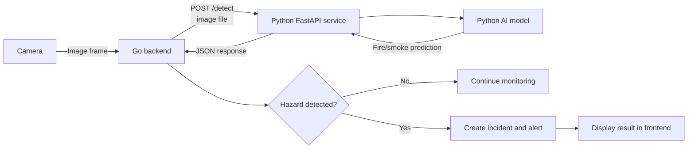

# Research: Connecting the Go Backend to the Python AI Model

**Project:** FireMeX  
**Research period:** 17/08/2026 - 23/08/2026  
**Research topic:** How the Go backend should communicate with the Python fire-and-smoke detection model

## 1. Research Objective

The purpose of this research was to identify a suitable way to connect the FireMeX Go backend with a machine-learning model written in Python. The required process should allow Go to send a camera image to Python, allow Python to detect fire or smoke, and return the detection result to Go.

The integration should:

- Keep the Go backend and Python model separated.
- Transfer camera images safely.
- Return structured fire and smoke detection results.
- Handle timeouts, invalid images, and model failures.
- Allow both components to be tested independently.

## 2. Integration Methods Considered

### Option 1: REST API

The Python model can run as a small web service using FastAPI or Flask. The Go backend can send an image through an HTTP request and receive the result as JSON.

**Advantages:**

- Simple to understand and implement.
- Go and Python already support HTTP communication.
- The services can run separately or in different containers.
- Requests can be tested using tools such as `curl` or Postman.
- JSON results are easy to inspect during development.

**Disadvantages:**

- Images and JSON introduce some communication overhead.
- Request timeouts and response validation must be implemented.

### Option 2: gRPC

Go and Python can communicate through gRPC using a shared Protocol Buffers definition.

**Advantages:**

- Provides a strongly defined communication contract.
- Uses efficient binary serialization.
- Suitable for high-performance service-to-service communication.

**Disadvantages:**

- Requires Protocol Buffers and generated client/server code.
- Adds unnecessary complexity for the initial FireMeX prototype.

### Option 3: Execute Python Directly from Go

The Go backend can start a Python script as a child process and exchange information through command-line arguments, files, or standard input and output.

**Advantages:**

- Can be used for a small local prototype.
- Does not require a separate web API.

**Disadvantages:**

- Creates tight coupling between Go and Python.
- Starting Python for every image could be slow.
- Process failures, timeouts, and concurrent requests are harder to manage.
- The model would be loaded repeatedly unless a long-running process were maintained.

## 3. Recommended Approach

The recommended approach is a **REST API using FastAPI**. The Python model should operate as a long-running detection service, while the Go backend should act as its HTTP client.

This design allows the Python service to load the machine-learning model once when it starts. Go can then send camera frames whenever detection is required without restarting or reloading the model for each image.

## 4. Proposed Process



The proposed process should work as follows:

1. The Go backend captures or retrieves an image from a camera.
2. Go checks that the image is a valid JPEG or PNG.
3. Go sends the image to the Python service using `POST /detect`.
4. Python receives and validates the uploaded image.
5. Python passes the image to the fire-and-smoke detection model.
6. The model returns the detected class, confidence value, and location of the object.
7. Python converts the prediction into a JSON response.
8. The same HTTP request returns the JSON response to Go.
9. Go validates the returned data and checks the confidence threshold.
10. If fire or smoke is detected, Go creates an incident and alert.
11. If no hazard is detected, Go continues monitoring the camera.

Python does not need to make a separate request back to Go. Go sends one request to Python and waits for Python's response through the same HTTP connection.

## 5. Proposed API Contract

### Request from Go to Python

```text
POST http://python-model:8100/detect
Content-Type: multipart/form-data
```

Proposed form fields:

| Field | Type | Description |
| --- | --- | --- |
| `image` | File | Camera image to be analysed |
| `threshold` | Number | Minimum confidence required |
| `annotate` | Boolean | Whether Python should return an image with detection boxes |

### Response when a hazard is detected

```json
{
  "hazard": true,
  "detections": [
    {
      "label": "smoke",
      "confidence": 0.82,
      "box": {
        "x1": 110.5,
        "y1": 74.0,
        "x2": 418.2,
        "y2": 356.8
      }
    }
  ],
  "model_version": "model-version-or-hash"
}
```

### Response when no hazard is detected

```json
{
  "hazard": false,
  "detections": [],
  "model_version": "model-version-or-hash"
}
```

## 6. Responsibilities of Each Component

### Go backend

The Go backend should:

- Obtain images from registered cameras.
- Decide when a camera frame should be analysed.
- Send the image to the Python API.
- Apply a request timeout so the backend does not wait indefinitely.
- Validate the JSON response and confidence values.
- Store confirmed incidents and alerts in the database.
- Make incident information available to the frontend.

### Python service

The Python service should:

- Load the AI model once during service startup.
- Provide a health-check endpoint such as `GET /health`.
- Provide the detection endpoint `POST /detect`.
- Validate image type, size, and dimensions.
- Run the image through the fire-and-smoke model.
- Return only supported labels such as `fire` and `smoke`.
- Return confidence values and bounding-box coordinates as JSON.
- Return a clear error response if inference cannot be completed.

## 7. Error Handling to Consider

| Possible problem | Proposed handling |
| --- | --- |
| Camera image is unavailable | Go should record the failure and retry later. |
| Image is invalid or too large | Python should reject it with an HTTP 400 or 413 response. |
| Python model is unavailable | Go should time out and mark detection as temporarily unavailable. |
| Model is still loading | Python should return HTTP 503. |
| No fire or smoke is detected | Python should return `hazard: false`. |
| Response contains invalid data | Go should reject it and avoid creating a false incident. |
| Database storage fails | Go should log the error and retry safely. |

## 8. Proposed Deployment

During local development, the services can run on the same computer:

```text
Go backend:    http://127.0.0.1:8080
Python model:  http://127.0.0.1:8100
```

The Go backend can use environment variables so the model address and timeout are configurable:

```env
MODEL_URL=http://127.0.0.1:8100
MODEL_TIMEOUT_MS=15000
```

If Docker Compose is used later, both services can join the same Docker network. Go can then connect to Python using its service name:

```env
MODEL_URL=http://model:8100
```

## 9. Research Conclusion

A REST API is the most suitable initial method for connecting the FireMeX Go backend to the Python model. It is simpler than gRPC, more maintainable than repeatedly executing Python from Go, and keeps the backend and AI responsibilities clearly separated.

The intended communication loop is:

```text
Camera image -> Go backend -> Python detection API -> AI model
             -> JSON result -> Go backend -> Incident/alert
```

This research provides the proposed technical design to follow during implementation. Actual implementation and testing should confirm the final endpoint, timeout, image limits, confidence thresholds, and response structure.

## 10. Research References

- [FastAPI request bodies](https://fastapi.tiangolo.com/tutorial/body/)
- [FastAPI file uploads](https://fastapi.tiangolo.com/tutorial/request-files/)
- [Go `net/http` package](https://pkg.go.dev/net/http)
- [Go `mime/multipart` package](https://pkg.go.dev/mime/multipart)
- [gRPC Go quick start](https://grpc.io/docs/languages/go/quickstart/)
- [gRPC Python quick start](https://grpc.io/docs/languages/python/quickstart/)
- [Go `os/exec` package](https://pkg.go.dev/os/exec)
- [Docker Compose networking](https://docs.docker.com/compose/how-tos/networking/)
